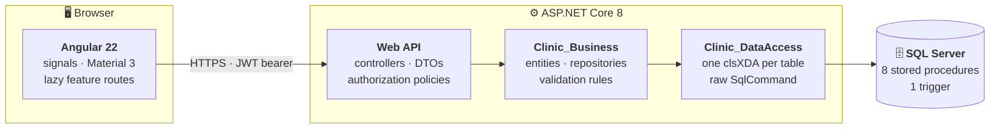
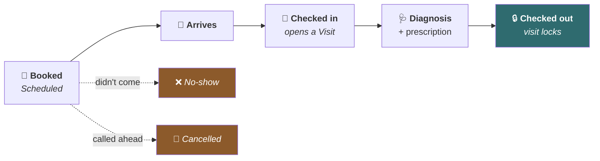
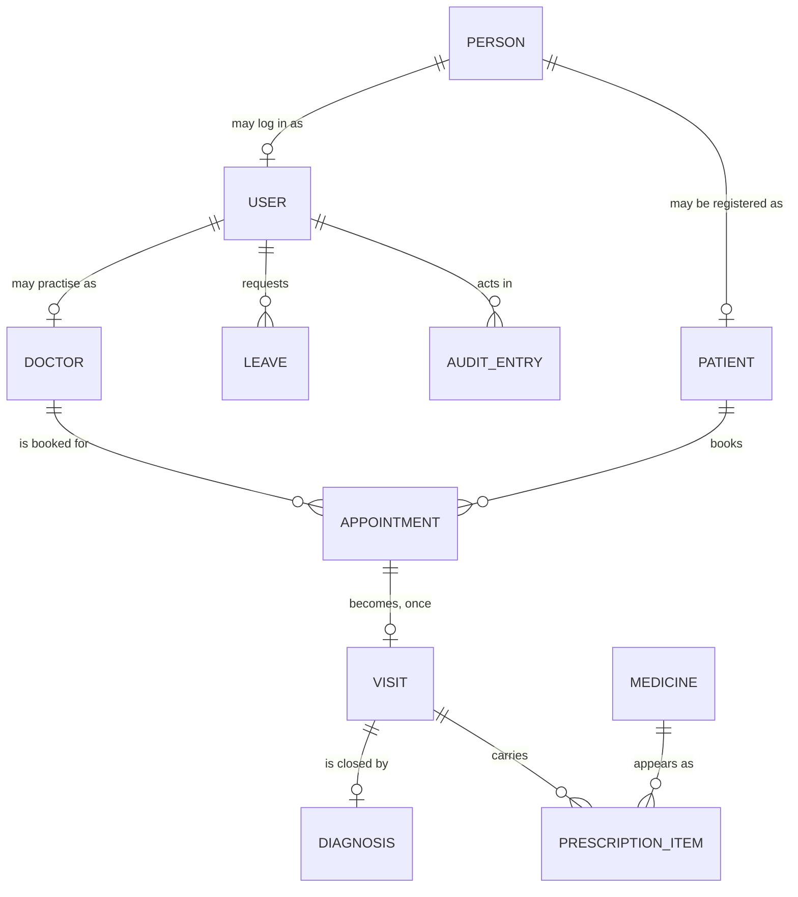
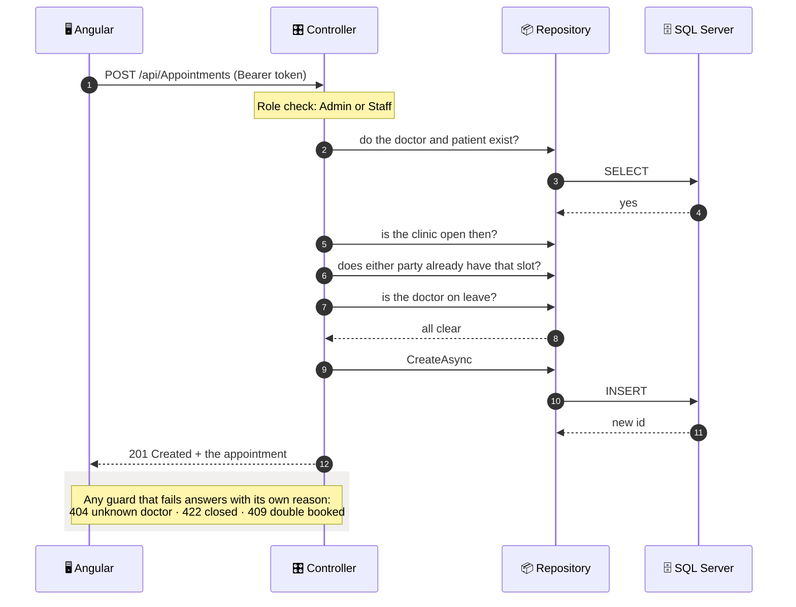
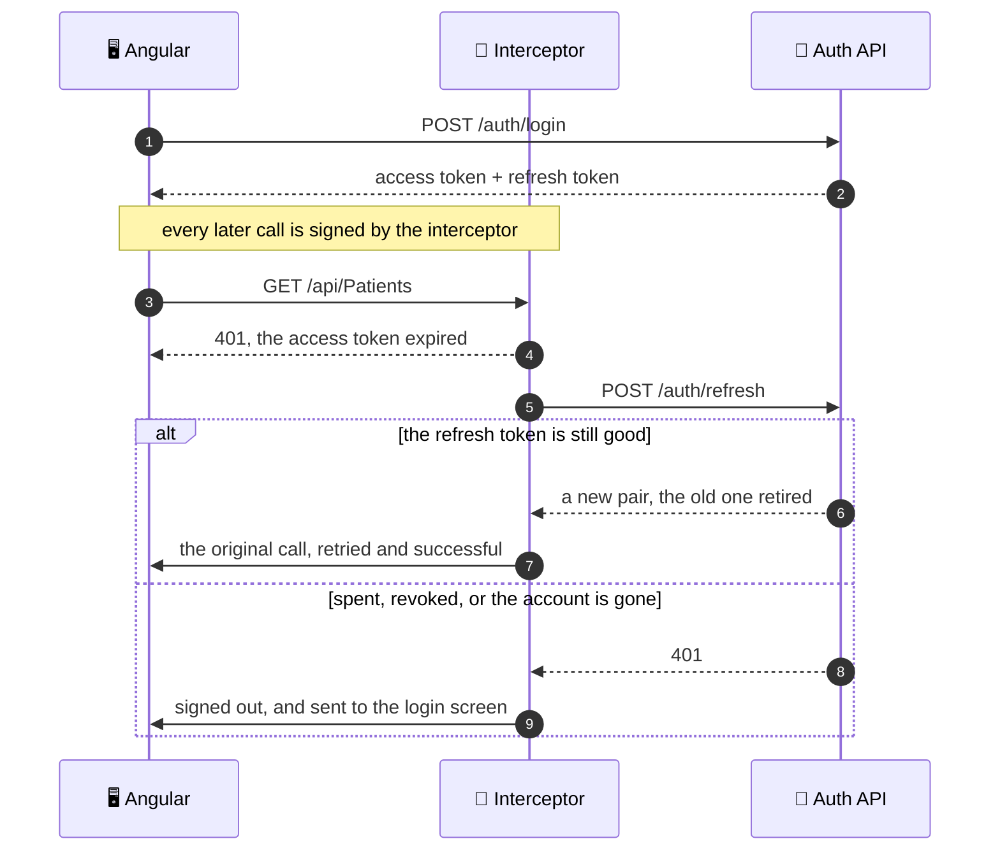

<div align="center">

# 🏥 Clinic Management System

**The appointment book, the patients behind it, and the visit record a booking turns into.**

[](https://dotnet.microsoft.com/)
[](https://angular.dev/)
[](https://learn.microsoft.com/en-us/sql/)
[](https://material.angular.dev/)
[](LICENSE)

</div>

---

## 📋 Table of contents

- [What it is](#-what-it-is)
- [Architecture](#%EF%B8%8F-architecture)
- [The clinic's day](#-the-clinics-day)
- [Features](#-features)
- [Who can do what](#-who-can-do-what)
- [The domain](#%EF%B8%8F-the-domain)
- [How a request travels](#-how-a-request-travels)
- [Staying signed in](#-staying-signed-in)
- [Built with](#%EF%B8%8F-built-with)
- [Project layout](#-project-layout)
- [Running it](#-running-it)
- [Decisions worth knowing](#-decisions-worth-knowing)
- [Status](#-status)

---

## 🎯 What it is

A web application for running a small clinic. It covers the appointment book, the patient
file, the visit record a booking turns into, and the staff side of it: accounts, leave
requests, a medicine list and an audit trail of who did what.

Three roles see three different apps. Reception books and checks people in, a doctor sees
only their own visits and leave, and an admin manages accounts, records and the trail.

> **Note**
> This is a learning project held to production standards. It has no customers and no
> deployment, and every record in the sample database is invented. The bar it is built to
> is that a real clinic could plausibly run it.

---

## 🏗️ Architecture

Three backend projects, one job each, plus a single-page frontend that never talks to the
database and never sees a connection string.



Every entity runs the same path. `clsXDA` reads rows, `clsX` maps and validates them, and
`IXRepository` is the only thing a controller is allowed to inject.

---

## 🔄 The clinic's day

The app follows the day as a chain, and each step locks a little more of the record.



A visit cannot be checked out without a diagnosis, and only a doctor can write one. Once
it is checked out, neither the diagnosis nor the prescription can change again.

---

## ✨ Features

| | Feature | What it means |
|:---:|---|---|
| 📅 | **Appointment book** | Book, reschedule and cancel. Double booking is refused for the same doctor *and* the same patient, as is anything outside the clinic's working hours. |
| 🎚️ | **Visual slot picker** | The doctor's day is drawn as a strip with their booked slots on it, so a clash shows up while you are choosing instead of arriving as a 409. |
| 🩺 | **The visit record** | Check in, write the diagnosis and the prescription, then check out, which locks both. |
| 👥 | **Patients and people** | A patient and a user are both a person, so the same record backs the file and the login. |
| 🏖️ | **Leave requests** | Staff and doctors request, an admin rules. An approved leave blocks bookings for that doctor. |
| 💊 | **Medicine catalogue** | Nearly 20,000 entries, searched by generic or brand name from the prescription form. |
| 📊 | **Excel export** | Any list, over a date range you choose, as a real `.xlsx` with typed cells and a frozen header. |
| 🔍 | **Audit trail** | Logins, failed logins, account changes and every permission denial, readable by an admin. |
| 🔐 | **Sessions that survive** | JWT access tokens with rotating refresh tokens, so a reload keeps you signed in. |

---

## 🔑 Who can do what

| | 👑 Admin | 🗂️ Staff | 🩺 Doctor |
|---|:---:|:---:|:---:|
| Book, reschedule, cancel appointments | ✅ | ✅ | ❌ |
| Browse appointments and visits | ✅ | ✅ | 🔸 own only |
| Check in, edit, check out a visit | ✅ | ✅ | ❌ |
| Write diagnosis and prescription | ✅ | ❌ | 🔸 own visits |
| Register and edit patients | ✅ | ✅ | ❌ |
| Open one patient | ✅ | ✅ | 🔸 own patients |
| Manage doctors, medicines, accounts | ✅ | ❌ | ❌ |
| Request leave | ❌ | ✅ | ✅ |
| Approve or reject leave | ✅ | ❌ | ❌ |
| Read the audit trail and statistics | ✅ | ❌ | ❌ |

> 🔸 **own only** means the server throws away whatever `doctorId` you sent and substitutes
> your own. Editing the query string changes nothing.

A role attribute runs before the action and can only ask *what role are you*. **Eight
resource policies** answer *is this yours*, and every refusal writes an `AccessDenied` row
to the audit trail.

---

## 🗺️ The domain



`PERSON` is the shared root: a name, a phone, a date of birth. A patient is a person, and
so is a user, which is why one human can be both without the details being typed twice.

The 1-to-1 edges are enforced by **unique indexes**, not by checking first and hoping. Two
simultaneous check-ins on the same appointment end with one visit and a 409, not two rows.

---

## 🛤️ How a request travels

Booking an appointment, from click to row, with every guard it has to clear.



Each refusal says what is actually wrong, as an RFC 9457 `ProblemDetails`. The frontend
renders the server's own sentence rather than a generic failure message.

---

## 🔐 Staying signed in

A short-lived access token does the work; a longer-lived refresh token renews it, once.



Refresh tokens rotate, so a replayed one is refused and logged as `RefreshRejected`.
Passwords are BCrypt hashed, and the login endpoint runs the same work whether or not the
account exists, so response time cannot be used to discover which emails are real.

**Rate limits** are per IP and per action: **5/min** on login, because it is the
brute-force target, **10/min** on register, **30/min** on refresh and logout, and
**300/min** globally.

---

## 🛠️ Built with

<table>
<tr><td valign="top" width="50%">

**⚙️ Backend**

- ASP.NET Core 8
- SQL Server via plain **ADO.NET**, no ORM
- JWT bearer + rotating refresh tokens
- BCrypt password hashing
- Per-endpoint rate limiting
- RFC 9457 `ProblemDetails` errors
- ClosedXML for the Excel export
- Swashbuckle / Swagger

</td><td valign="top" width="50%">

**🖥️ Frontend**

- Angular 22, standalone throughout
- Signals: `linkedSignal`, `httpResource`
- Signal forms
- Angular Material 3 as a *theme*
- Lazy-loaded feature routes
- `OnPush` change detection everywhere
- Loading, empty and error states per screen

</td></tr>
</table>

---

## 📁 Project layout

```
📦 backend/
 ┣ 📂 Clinic Management System/   the web API: controllers, DTOs, authorization, Program.cs
 ┣ 📂 Clinic_Business/            entities, repositories, interfaces
 ┣ 📂 Clinic_DataAccess/          one clsXDA per table, raw SqlCommand
 ┗ 📄 ClinicManagementSystem.bak  the database: schema, procedures and sample data

📦 frontend/src/app/
 ┣ 📂 core/       auth, interceptors, the API service, utilities
 ┣ 📂 shared/     services, reusable components, the dashboard layout
 ┗ 📂 features/   one folder per screen, thirteen of them
```

---

## 🚀 Running it

**Prerequisites:** .NET 8 SDK · Node 20+ · a SQL Server instance

<table><tr><td>

**1️⃣ Restore the database**

`backend/ClinicManagementSystem.bak` holds the schema, the stored procedures and sample
records. Restore it as `ClinicManagementSystem`.

</td></tr><tr><td>

**2️⃣ Set the two secrets**

Neither lives in the repository, and the API refuses to start without them, naming the one
that is missing.

```bash
cd "backend/Clinic Management System"
dotnet user-secrets set "Jwt:Key" "any random string of 32 characters or more"
dotnet user-secrets set "ConnectionStrings:Clinic" "your SQL Server connection string"
dotnet run
```

Swagger lands at **https://localhost:7180/swagger**

</td></tr><tr><td>

**3️⃣ Start the frontend**

It proxies `/api` to the backend, so the two run together.

```bash
cd frontend
npm install
npm start
```

The app lands at **http://localhost:4200**

</td></tr></table>

> 💡 Every sample account in the backup shares the password `123456`. They are invented
> records in a local database, meant to be signed into while you look around.

---

## 💡 Decisions worth knowing

<details>
<summary><b>🚫 No ORM, on purpose</b></summary>
<br>

Every query is a hand-written `SqlCommand`. It is more code than EF Core would be, and
that is the point: the project exists partly to work at that level, where paging, joins
and parameterisation are things you write rather than things you configure.

</details>

<details>
<summary><b>💥 The data access layer never swallows exceptions</b></summary>
<br>

There are no `try`/`catch` blocks in `Clinic_DataAccess`, so a `SqlException` reaches
`UseExceptionHandler` and becomes a 500 with a `traceId`.

A `false` or `null` return therefore means *validation failed* or *zero rows*, never
*something threw*. That is what makes the difference between a 422 and a 500 meaningful in
the controllers rather than decorative.

</details>

<details>
<summary><b>🛡️ Authorization a role attribute cannot express is imperative</b></summary>
<br>

`[Authorize(Roles = ...)]` runs before the action and cannot see *which* visit was asked
for, so rules like "is this your patient" are `IAuthorizationHandler`s checked in the
method body.

Denials answer **404 rather than 403** wherever a 403 would confirm that the record exists,
so nobody can map the clinic by probing ids.

</details>

<details>
<summary><b>🕐 Times are stored as <code>datetimeoffset</code>, with the browser's own offset</b></summary>
<br>

An appointment keeps the wall clock the receptionist actually read. `toISOString` would
have sent the same instant as `...Z` and stored `+00:00`, which reads back an hour or
three wrong anywhere east or west of UTC.

</details>

<details>
<summary><b>🔒 Concurrency is enforced by the database, not by a prior read</b></summary>
<br>

Check-in and prescriptions each carry a unique index, so two simultaneous requests end
with one row and a 409 rather than two rows and a corrupted record.

Booking is the one create path still open to the race. It is a known gap rather than an
unexamined one.

</details>

<details>
<summary><b>🔓 <code>WorkingDays</code> is deliberately open</b></summary>
<br>

When the clinic is open is public information, so that one controller carries no
`[Authorize]`. Every other controller does.

</details>

<details>
<summary><b>💾 The schema lives in the <code>.bak</code> and nowhere else</b></summary>
<br>

There are no migrations and no `.sql` files. Eight stored procedures and a trigger exist
only inside the database, so the backup is the only complete copy of the schema.

</details>

<details>
<summary><b>🧪 No automated tests</b></summary>
<br>

A deliberate choice for this project, not an oversight.

</details>

---

## 📌 Status

Built to the standard that a real clinic could plausibly run it, which is why loading,
empty, error and permission-denied states are part of every screen rather than a later
pass.

**Known and deliberate gaps**, kept here rather than left to be discovered:

- 🏁 Booking's create race, the one of three create paths without a unique index behind it
- 🔢 A paged total that refetches rather than returning two result sets
- 🌐 No forwarded headers or HSTS until there is a real proxy to configure them against
- 💊 A medicine catalogue with no retirement path once a drug has been prescribed

---

<div align="center">

**📄 [MIT](LICENSE)** · Built by [Saleh Abuhussein](https://github.com/SalehAbuhussein)

</div>
