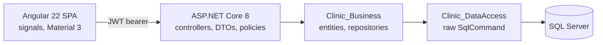
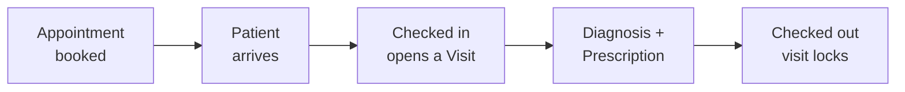

# Clinic Management System

[](https://dotnet.microsoft.com/)
[](https://angular.dev/)
[](https://learn.microsoft.com/en-us/sql/)
[](https://material.angular.dev/)
[](LICENSE)

A web application for running a small clinic: the appointment book, the patients behind
it, and the visit record a booking turns into. It also covers staff accounts, leave
requests, a medicine list and an audit trail of who did what.

ASP.NET Core 8 API with raw ADO.NET, Angular 22 frontend with Material 3.



## What it does

The clinic's day runs as a chain, and the app follows it:



- Book, reschedule and cancel appointments, with double booking refused for the same
  doctor or patient, and bookings outside the clinic's working hours refused too
- Check a patient in, which opens their visit and marks the appointment attended
- Record a diagnosis and a prescription against a visit, then check it out, which locks
  both against further edits
- Keep patients, doctors, people and a medicine list
- Request leave, and have an admin approve or reject it; an approved leave blocks
  bookings for that doctor
- Sign in with email and password, stay signed in through refresh tokens, and change or
  reset a password
- Export any list to a real `.xlsx` over a date range you choose
- Read an audit trail of logins, failed logins, account changes and access denials

Three roles see three different apps. Reception books and checks people in, a doctor sees
only their own visits and leave, and an admin manages accounts, records and the trail.

Nothing is hard deleted where history depends on it. Users are deactivated, and a person
can only be removed while no user or patient belongs to them.

### Who can do what

| | Admin | Staff | Doctor |
|---|:---:|:---:|:---:|
| Book, reschedule, cancel appointments | ● | ● | – |
| Browse appointments and visits | ● | ● | own only |
| Check in, edit, check out a visit | ● | ● | – |
| Write diagnosis and prescription | ● | – | own visits |
| Register and edit patients | ● | ● | – |
| Open one patient | ● | ● | own patients |
| Manage doctors, medicines, accounts | ● | – | – |
| Request leave | – | ● | ● |
| Approve or reject leave | ● | – | – |
| Read the audit trail and statistics | ● | – | – |

A role attribute runs before the action and can only ask *what role are you*. Eight
resource policies answer *is this yours*, and every refusal writes an `AccessDenied` row
to the audit trail.

## Built with

**Backend.** ASP.NET Core 8, SQL Server reached through plain ADO.NET with no ORM,
JWT bearer tokens with rotating refresh tokens, BCrypt password hashing, per-endpoint
rate limiting, RFC 9457 `ProblemDetails` errors, ClosedXML for the Excel export,
Swashbuckle for Swagger.

**Frontend.** Angular 22, standalone components throughout, signals for state including
`linkedSignal` and `httpResource`, signal forms, Angular Material 3 as a theme rather
than replacement components, lazy-loaded feature routes.

## Project layout

```
backend/
  Clinic Management System/   the web API: controllers, DTOs, authorization, Program.cs
  Clinic_Business/            entities, repositories, interfaces
  Clinic_DataAccess/          one clsXDA per table, raw SqlCommand
  ClinicManagementSystem.bak  the database, schema and sample data
frontend/
  src/app/core/               auth, interceptors, the API service
  src/app/shared/             services, reusable components, the dashboard layout
  src/app/features/           one folder per screen, thirteen of them
```

Each backend entity runs the same path: `clsXDA` reads the rows, `clsX` maps and
validates them, `IXRepository` is what controllers inject.

## Running it

You need the .NET 8 SDK, Node 20 or newer, and a SQL Server instance.

**1. Restore the database.** `backend/ClinicManagementSystem.bak` holds the schema, the
stored procedures and sample records. Restore it as `ClinicManagementSystem`.

**2. Set the two secrets.** Neither lives in the repository, and the API refuses to start
without them, naming the one that is missing.

```bash
cd "backend/Clinic Management System"
dotnet user-secrets set "Jwt:Key" "any random string of 32 characters or more"
dotnet user-secrets set "ConnectionStrings:Clinic" "your SQL Server connection string"
dotnet run
```

Swagger is at `https://localhost:7180/swagger`.

**3. Start the frontend.** It proxies `/api` to the backend, so both run together.

```bash
cd frontend
npm install
npm start
```

The app is at `http://localhost:4200`.

The sample accounts in the backup all share the password `123456`. They are invented
records in a local database and are meant to be signed into while you look around.

## Decisions worth knowing

**No ORM.** Every query is hand-written `SqlCommand`. It is more code than EF Core would
be, and it is the point: the project exists partly to work at that level.

**The data access layer never swallows exceptions.** There are no try/catch blocks in
`Clinic_DataAccess`, so a `SqlException` reaches `UseExceptionHandler` and becomes a 500
with a `traceId`. A `false` or `null` return therefore means "validation failed" or
"zero rows", never "something threw", which is what makes the difference between a 422
and a 500 meaningful in the controllers.

**Authorization that a role attribute cannot express is imperative.**
`[Authorize(Roles = ...)]` runs before the action and cannot see which visit was asked
for, so rules like "is this your patient" are `IAuthorizationHandler`s checked in the
method body. Denials answer 404 rather than 403 where a 403 would confirm the record
exists.

**Times are stored as `datetimeoffset`, written with the browser's own offset.** An
appointment keeps the wall clock the receptionist read. `toISOString` would have sent the
same instant as `...Z` and stored `+00:00`, which reads back wrong anywhere east or west
of UTC.

**Concurrency is enforced by the database, not by a prior read.** Check-in and
prescriptions each carry a unique index, so two simultaneous requests end with one row
and a 409 rather than two rows. Booking is the one create path still open to the race,
which is a known gap rather than an unexamined one.

**`WorkingDays` is deliberately open.** When the clinic is open is public information,
so that one controller carries no `[Authorize]`. Every other controller does.

**The schema lives in the `.bak` and nowhere else.** There are no migrations and no
`.sql` files. Eight stored procedures and a trigger exist only inside the database, so
the backup is the only complete copy.

**No automated tests.** A deliberate choice for this project, not an oversight.

## Status

A learning project held to production standards. It has no customers and no deployment,
and the records in the backup are invented. The bar it is built to is that a real clinic
could plausibly run it, so loading, empty, error and permission-denied states are part of
every screen rather than a later pass.

Known and deliberate gaps, kept here rather than left to be discovered: booking's create
race, a paged total that refetches rather than returning two result sets, no forwarded
headers or HSTS until there is a real proxy to configure them against, and a medicine
catalogue with no retirement path once a drug has been prescribed.

## License

[MIT](LICENSE)
